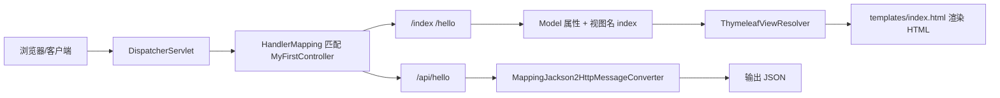

## springboot-web

### 项目总览

一个最简单的 Spring Boot Web 项目，寥寥几个类即可实现一个 web 服务端的搭建。  

### 步骤说明

- 在 [pom.xml](pom.xml) 中引入 spring-boot-starter-webmvc 依赖。
- 定义一个 `@SpringBootApplication` 启动类 [Application.java](src/main/java/com/hyao/web/Application.java)。
- 写一个 Controller 示例 [MyFirstController.java](src/main/java/com/hyao/web/controller/MyFirstController.java)。
- 这样一个 web 服务端就写好了，启动后可以直接调用 controller 中的接口.

### 知识汇总

#### 简单注解

- `@SpringBootApplication`: 标记启动类。

> 启动类的固定写法：
>
> ```java
> @SpringBootApplication
> public class Application {
>     public static void main(String[] args) {
>         SpringApplication.run(Application.class, args);
>     }
> }
> ```

- `@Controller`: controller 类注解。

> 表示该类是一个 controller 类，用于处理请求。  
> 如果请求方法上没有 `@ResponseBody` 注解，返回值表示视图名，将被视图解析器解析。  
> 相反如果有 `@ResponseBody` 注解，返回值将被写入 HTTP 响应体中。

- `@RestController`: RESTful controller 类注解。

> 表示该类是一个 RESTful controller 类，专门用于处理 RESTful 接口请求。他是 `@Controller` + `@ResponseBody` 的结合体。  
> 加了该注解的 controller 类下的方法返回值将被写入 HTTP 响应体中，不会被视图解析器解析。

- `@RequestMapping`: 请求映射注解。

> - **当该注解标记在 controller 类上时**，一般时用于配置该 controller 的公共请求地址。  
> - **当注解标记在方法上时**，表示该方法是一个请求处理方法，同时指定该方法的请求地址。
>
> 调用接口时，需要将类上注解的请求地址和方法上注解的请求地址合并。  
>
> **举个例子**
>
> ```java
> @Controller
> @RequestMapping("/api")
> public class Controller {
>     // 该方法的请求地址是 /api/test
>     @RequestMapping("/test")
>     public String test() {
>         return "test";
>     }
> }
> ```

- `@ResponseBody`: 响应体注解。

> - **当该注解标记在 controller 类上时**，表示该类下的所有方法返回值将被写入 HTTP 响应体中，不会被视图解析器解析。
> - **当该注解标记在方法上时**，表示该方法的返回值将被写入 HTTP 响应体中，不会被视图解析器解析。

- `@GetMapping`: GET 请求方法注解。

> 等价于 `@RequestMapping(method = RequestMethod.GET)`。  
> 类似的还有：  
>
> - `@PostMapping`: POST 请求方法注解。  
> - `@PutMapping`: PUT 请求方法注解。  
> - `@DeleteMapping`: DELETE 请求方法注解。  
> - `@PatchMapping`: PATCH 请求方法注解。

- `@RequestParam`: 请求参数注解。

> **举个例子**  
>
> ```shell
> curl http://localhost:8080/get1?id=123
> ```
>
> ```java
> @GetMapping("/get1")
> public Map<String, Object> get1(@RequestParam("id") String id){
>     // id = 123
>     return Map.of("id", id);
> }
> ```
>
> Spring Boot 会自动将请求路径`?`后面的参数 `id` 绑定到方法中的参数 `id` 上。

- `@PathVariable`: 请求路径变量注解。

> 配合 `@RequestMapping` (或 `@GetMapping` 等等)使用，表示从请求路径中获取变量。
>
> **举个例子**
>
> ```shell
> curl http://localhost:8080/get2/123
> ```
>
> ```java
> @GetMapping("/get2/{id}")
> public Map<String, Object> get2(@PathVariable("id") String id){
>     // id = 123
>     return Map.of("id", id);
> }
> ```
>
> Spring Boot 会自动将请求路径中占位符 `id` 的值绑定到方法中的参数 `id` 上。

- `@RequestBody`: 请求体注解。

> 表示该方法的参数将从请求体中获取数据。 
>
> **举个例子**
>
> ```shell
> curl -X POST http://localhost:8080/post -H "Content-Type: application/json" -d "{\"name\":\"hyao\"}"
> ```
>
> ```java
> @PostMapping("/post")
> public Map<String, Object> post(@RequestBody Map<String, Object> params) {
>     // params = {"name": "hyao"}
>     return Map.copyOf(params);    
> }
> ```
>
> `@RequestBody` 会将请求体中的 JSON 数据自动绑定到 `params` 上，但是有个前提，请求头包含 `Content-Type: application/json`。

#### 请求图示



### 总结

很简单，没啥总结的。

---

<div style="text-align: center">
<h4>OK，知道以上内容，你就可以实现一个简单的 Spring Boot Web 项目了。</h4>
</div>